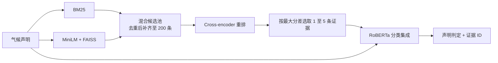
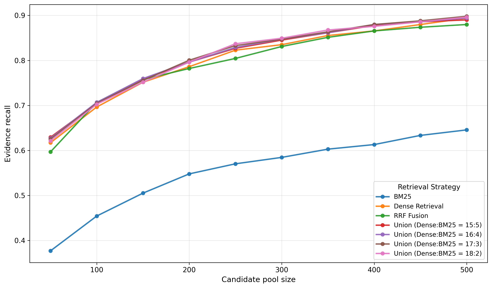

# climate-claim-verifier

基于证据的气候声明核查系统

给定一条气候声明，系统从 **1,208,827 条证据段落**中召回并重排证据，返回声明判定和可追溯的证据 ID。在 154 条声明的开发集上，混合检索取得 **80.04% Recall@200**，端到端声明准确率达到 **59.09%**。

[查看预测](#查看预测) · [实验结果](#实验结果) · [复现指南](docs/reproduction.md)

## 查看预测

在仓库根目录运行以下命令，查看开发集中的声明、模型判定和证据 ID。此命令读取保存的预测文件，仅依赖 Python 标准库。

```bash
python3 -m climate_verification inspect claim-2580 \
  --predictions predictions/end_to_end_outputs/max_gap_ensemble_dev_prediction.json
```

示例的输出为 `DISPUTED`，并附五条证据 ID。在 [预测示例](#预测示例) 中可以查看对应的证据与结果分析。

## 系统结构



1. **候选召回。** 合并 dense 前 170 条和 BM25 前 30 条，去重后用后续 dense 结果补齐。Dense 检索器使用多负例排序损失和挖掘到的难负样本做微调。
2. **证据重排。** MiniLM cross-encoder 对声明与候选证据逐对评分。训练时用标注证据的得分分位数过滤疑似假负例。推理时根据相邻得分的最大落差决定截断位置。
3. **声明分类。** 将选中证据和原声明交给 DistilRoBERTa、RoBERTa-base 和 RoBERTa-large-MNLI，以 0.3、0.3、0.4 加权预测 `SUPPORTS`、`REFUTES`、`NOT_ENOUGH_INFO` 或 `DISPUTED`。

## 实验结果

数据包含 1,228 条训练声明、154 条开发集声明和 153 条无标签测试声明。以下指标均来自开发集。候选 Recall@200 在重排前计算，端到端证据 F1 基于最终返回的证据 ID，综合分数为证据 F1 与声明准确率的调和平均。

### 候选召回

| 召回策略 | 证据 Recall@200 |
| --- | ---: |
| BM25 | 54.79% |
| Dense | 78.62% |
| RRF 融合 | 78.21% |
| Dense 170 + BM25 30 去重并集 | **80.04%** |



### 端到端与消融

| 方案 | 证据 F1 | 声明准确率 | 调和平均 |
| --- | ---: | ---: | ---: |
| RRF Top-5，无重排 + 集成 | 19.49% | 55.19% | 28.80% |
| 重排 Top-5 + 单个 DistilRoBERTa | 24.13% | 51.95% | 32.95% |
| 重排 Top-5 + 集成 | 24.13% | 59.09% | 34.26% |
| **重排 + 最大分差截断 + 集成** | **25.46%** | **59.09%** | **35.59%** |

### 证据选择

在相同重排设置下，对比固定返回 Top-5 与按最大分差动态截断。

| 证据选择策略 | 证据精确率 | 证据召回率 | 证据 F1 |
| --- | ---: | ---: | ---: |
| 固定 Top-5 | 20.39% | **34.92%** | 24.13% |
| 最大分差截断 | **30.30%** | 26.85% | **25.46%** |

最大分差截断提高了证据精确率，同时减少返回的相关证据，最终证据 F1 提升 **1.33 个百分点**。相较 RRF Top-5 无重排方案，最终系统的证据 F1 提高 **5.97 个百分点**，调和平均提高 **6.79 个百分点**。 [保存的实验结果](predictions/end_to_end_outputs/end_to_end_summary.json)

## 预测示例

以下展示一个正确判定案例和一个错误案例，分别说明证据检索与证据聚合的效果。

| 声明 | 模型判定 | 数据集标注 | 证据与判定 |
| --- | --- | --- | --- |
| 火山每年排放约 3 亿吨二氧化碳（[claim-2580](predictions/end_to_end_outputs/max_gap_ensemble_dev_prediction.json#L90)） | `DISPUTED` | `DISPUTED` | 命中两条标注证据。返回的段落还包含对全球火山排放量的不同估算。 |
| 约 97% 的气候专家同意人类导致全球变暖（[claim-1698](predictions/end_to_end_outputs/max_gap_ensemble_dev_prediction.json#L1096)） | `SUPPORTS` | `DISPUTED` | 两条标注证据均被检出。一段直接支持声明，另一段的 97% 指「同意气温上升」，84% 才对应「认为人为变暖正在发生」。模型错误地预测为 `SUPPORTS`，标注标签为 `DISPUTED`。 |

这两个例子体现了证据召回与聚合的区别。获取相关段落之后，核查还需要识别各段的统计口径和相互关系。 [查看完整预测及证据 ID](predictions/end_to_end_outputs/max_gap_ensemble_dev_prediction.json)

## 安装与复现

训练和评估使用 Python 3.11，完整数据训练建议使用 CUDA GPU。安装后可运行 `climate-claim-verifier --help` 查看命令。

```bash
python -m pip install -e .
climate-claim-verifier --help
```

[复现指南](docs/reproduction.md) 提供输入数据格式、分阶段训练、消融和评分命令。完整数据与模型权重需单独准备，仓库提供预测文件和实验摘要。输入数据放在本地 `data/` 目录或通过 `--data-dir` 指定。

## 仓库导航

| 位置 | 内容 |
| --- | --- |
| [climate_verification/retrieval/](climate_verification/retrieval/) | 混合召回、负样本挖掘、重排与证据导出 |
| [climate_verification/classification/](climate_verification/classification/) | 分类配置、输入构建、模型训练与集成 |
| [climate_verification/evaluation.py](climate_verification/evaluation.py) | 证据 F1、分类准确率和调和平均 |
| [predictions/](predictions/) | 已保存的开发集预测、测试集输出与模型摘要 |

## 许可证

代码采用 [MIT 许可证](LICENSE)。
